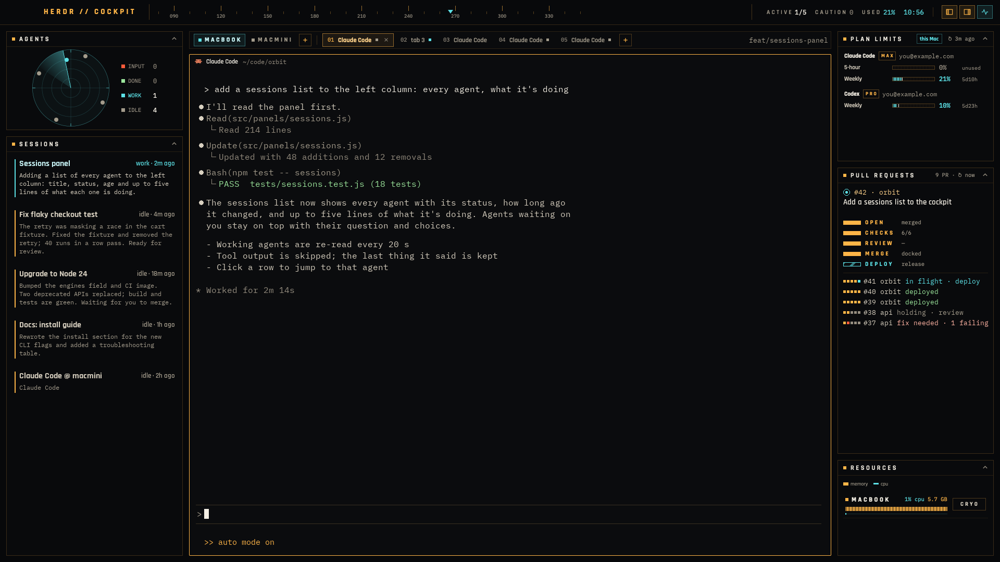

# Cockpit for Herdr

A flight-HUD layout for the [Herdr](https://herdr.dev) desktop app. It puts every coding agent you run on one screen:

- **Agents**: a radar of your agents and their status counts.
- **Sessions**: what every agent is doing, in a few lines each. Agents that need you come first, with their choices as buttons.
- **Plan limits**: Claude Code and Codex usage for the machine of the space you're in, with the account and plan.
- **Pull requests**: open and just-merged PRs as five stages (open, checks, review, merge, deploy).
- **Resources**: CPU and memory per space, with CRYO / WAKE to put a space's agents to sleep and resume the same conversations.



## Install

Ask your agent:

> Read ~/.config/herdr-app/AGENTS.md, then add the Herdr layout from https://github.com/kyujonglee/herdr-cockpit

Or copy the files yourself:

```sh
git clone https://github.com/kyujonglee/herdr-cockpit
cp herdr-cockpit/layouts/cockpit.* ~/.config/herdr-app/layouts/
cp -R herdr-cockpit/mods/cockpit ~/.config/herdr-app/mods/
herdr-app check ~/.config/herdr-app/mods/cockpit
herdr-app do layout.switch '{"name":"cockpit"}'
```

`ctrl-shift-l` switches layouts back.

## Before you add it

This mod runs programs on your machine and reads files outside its own folder:

- `claude`, `codex app-server`, `gh`, `git`, `ps`, `lsof`, `sysctl` and `open`.
- `kill -TERM`, only when you press CRYO twice.
- `hc exec` on your connected machines.
- `~/.claude/sessions/*.json`.

It shows your account email on screen only. It sends keys to a terminal only when you press one of an agent's choice buttons.

It is built and tested on macOS. Read [RECIPE.md](RECIPE.md) for every detail and the known limits.

## Fonts

The bundled fonts are under the SIL Open Font License; their license files are in `mods/cockpit/fonts/`:

- Rajdhani (Indian Type Foundry)
- IBM Plex Mono (IBM)
