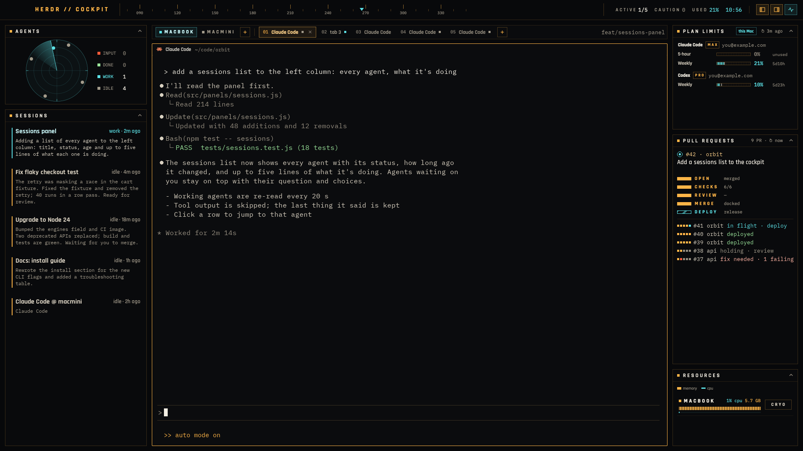

# Telemetry

A flight-HUD layout for people who run several coding agents at once. The terminal sits in the middle. On the left are a small radar of your agents and a **Sessions** list showing what every agent is doing, in a few lines each. On the right are your **plan limits** (Claude Code and Codex, for the machine you're on), your **pull requests** as five docking stages, and **resources** per space, with a CRYO button that puts a space's agents to sleep without losing their conversations. Everything is amber and cyan on near-black, in Rajdhani and IBM Plex Mono.



## What you see

The window has no title bar. It is a column: a 48 px bar on top, and under it a row with 12 px padding and 12 px gaps holding three columns. The left and right columns are 300 px; the center takes the rest.

The palette:

| Use | Color |
|---|---|
| Background | `#07080a` |
| Panels | `#0a0b0dcc`, with a 1 px `#ffb54733` frame |
| Amber | `#ffb547` (hi `#ffd28a`) |
| Cyan | `#5ce1e6` (hi `#c9f6f8`) |
| Red | `#ff5b3a` (soft `#ffb3a3`) |
| Green | `#9be59b` |
| Text | ink `#f4efe4`, text `#d8d0c0`, muted `#a39b8b`, dim `#958d7f` |
| Cryo | `#6f7f99` |

Labels are Rajdhani, uppercase, with hair-space tracking. Figures are IBM Plex Mono. The layout's theme is `graphite`, with the colors above as overrides.

**Bar (48 px, draggable).** From left to right:
- `HERDR // TELEMETRY` in amber, leaving room for the traffic lights at (18, 17).
- A heading tape: ticks every 10°, numbered every 30°, sliding slowly, with a cyan ▼ marker.
- Readouts:
  - **Active** `working/total`.
  - **Caution** `n`. Red and blinking when an agent needs input.
  - **Used** `n%`: the fullest plan limit on the shown machine, colored cyan below 70, amber from 70, red from 90.
- A clock (HH:MM).
- Two 30×26 toggles that show or hide the left and right columns.
- A motion toggle.

**Left column.**
- **Agents** (190 px):
  - A 150 px radar scope with a turning sweep. Each agent is a mark on a ring: input nearest the center, then done, working, idle, and asleep at the rim.
  - Beside it, four counts: INPUT / DONE / WORK / IDLE.
- **Sessions** (the rest):
  - Agents that need input come first, as a red-framed card with:
    - the agent's title and where it is
    - what it's asking about, in mono on black. For Claude Code this is the waiting tool call read from its transcript: the whole Bash command with its description, or the file an edit goes to. Otherwise it's the box on screen.
    - the question (for a multi-question form, `2 of 3 · header` above it)
    - its choices, one per row: number, label, and the option's description (from the transcript when the screen cuts it)
    - for a multiple choice, a checkbox per row and a **Submit · n ticked** button
    - when the menu has a free-text choice ("Type something"), a field: **Your own answer · Enter sends**
    - an **Open** button
  - Then every other agent as a row:
    - a 2 px status stripe
    - the task title (the terminal title Claude Code sets, else the tab name), in green, cyan or text color
    - `status · age` on the right
    - up to five lines of what it's doing, in mono 11/16 px
  - Asleep agents follow as one dim line each.

**Center column.**
- **Tab strip** (34 px):
  - Space chips. The active one is framed cyan; each has a status dot.
  - A + that makes a new space.
  - Numbered tabs. The active one is framed amber with a ×.
  - A + that opens Herdr's own "new" menu (a terminal, or any installed agent such as Claude Code).
  - At the right, the focused pane's git branch.
- **Terminal** with Herdr's pane header (28 px), an amber 1 px frame, and a full amber frame when focused.

**Right column.**
- **Plan limits** (250 px):
  - A cyan chip in the title strip names the machine (`this Mac` or a connected machine's name), with `↻ age` beside it.
  - One group per provider: the name, a plan chip (MAX / PRO) and the signed-in email.
  - Under each group, one row per limit window:
    - the window name (5-hour, Weekly, Weekly · Fable)
    - a segmented gauge: fill is the share used, a 1 px tick is the share of the window passed (red when you are burning faster than time)
    - `n%`
    - time to reset (`5d10h`), or "unused" / "fast"
- **Pull requests** (weight 3):
  - The PR for the shown space's branch docks first: `#n · repo`, its title in two lines, then five stage rows: OPEN, CHECKS, REVIEW, MERGE, DEPLOY.
  - Each stage row has a short tube (filled amber when done, striped cyan and moving while running, red when failed), the name, and its detail (`6/6`, `2 failing`, `docked`, the deploy's name).
  - Below, every other PR as a 20 px line: five stage dots, `#n repo`, and a verdict (`deployed`, `in flight · deploy`, `fix needed · 2 failing`, `holding · review`).
- **Resources** (weight 1):
  - One row per local space: name, `n% cpu`, `n GB`, an amber segmented memory rod and a thin cyan CPU bar.
  - A CRYO button (it reads WAKE when the space is asleep).

Every panel has a 28 px title strip. Clicking the strip folds the panel to the strip, which then shows a one-line summary (for example `Claude 21% Codex 10%`, or `#3199 api · fix needed (2 failing)`).

## How it behaves

**Agent statuses.**

| Status | Radar | Sessions | Elsewhere |
|---|---|---|---|
| blocked | red square at r 23, blinking, red halo | red card with question and choices; panel frame turns red | bar's Caution blinks red |
| done | green dot at r 40 | green title, recap text | — |
| working | cyan dot at r 55 | cyan title, what it last said | the sweep turns only while something works or waits |
| idle | grey dot at r 67 | dim text | — |
| asleep (cryo) | hollow square at the rim | one dim line, "asleep" | — |

**Clicks.**
- A radar mark or a Sessions row goes to that agent (`agent.focus`). Hovering shows where it is.
- Answering a blocked agent from its card. Every answer first re-reads the screen and goes ahead only if the same question and choices are still showing; otherwise it opens the agent. Each answer is sent once.
  - One choice: arrows from the cursor to it, then Enter.
  - Several choices: tick the rows (nothing is sent yet), then **Submit**. It presses the numbers whose box differs from what you ticked, types your own answer into the free field if you wrote one, moves to Submit and presses Enter.
  - Your own answer: Enter in the field presses the free choice's number, then pastes the text with Enter (`hc send --force`).
  - A question form that ends on "Ready to submit your answers?" is submitted too.
- Bar:
  - Caution goes to the agent that needs you; at 0 it shows the left column.
  - The toggles show or hide a column.
  - The motion toggle stops every animation.
- Tab strip:
  - A space chip selects it; double-click renames it.
  - A tab selects it; double-click renames, right-click opens Herdr's tab menu, × closes, and the wheel switches tabs.
- Plan limits: `↻` reads again.
- Pull requests: a PR or a stage opens it on GitHub (CHECKS opens `/checks`).
- Resources:
  - CRYO needs two separate presses within 4 s. A double-click doesn't count. The second press reads `QUIT n BUSY?` if agents are working.
  - CRYO quits the space's Claude Code and Codex agents, keeping their conversation ids. WAKE resumes them in the same terminals (`claude --resume`, `codex resume`).

**What moves.**
- The heading tape slides.
- The sweep turns while agents work.
- Blocked marks and cards blink.
- PR stages that are running stripe sideways.
- Gauges, rods and bars glide to new values.
- Motion pauses while the window is in the background and stops entirely with the motion toggle.

**When it reads.**

| What | How often | How |
|---|---|---|
| Sessions | when an agent's state changes; a working agent also every 20 s | its screen's last 80 lines: Claude Code's `※ recap:`, else its last paragraph of prose, else its last step; the menu at the bottom |
| Waiting tool call | when a Claude Code agent turns blocked, then up to 3 more times 3 s apart until found | `hc get` → its pid → `~/.claude/sessions/<pid>.json` (session id, folder) → the last 400 KB of `~/.claude/projects/<folder>/<session>.jsonl`; the newest `tool_use` without a `tool_result` |
| Plan limits | every 5 min, for this Mac and every connected machine | the shown one follows the active space |
| Pull requests | every 90 s, or 30 s while something runs | skipped while hidden or folded |
| Resources | every 5 s | skipped while hidden or folded |

**Narrow windows.** When the window crosses below 1400 px, the right column hides; below 1150, the left. They come back when it widens again by 40 px. Columns you hid yourself stay hidden.

## Built from

**Layout** `layouts/telemetry.json`:

```
root column  (titlebar none, traffic_lights [18,17], theme graphite, ui_font Rajdhani,
              background #07080a, terminal_padding [12,10], color overrides)
├─ c-bar     block 48 px, window_drag          mod telemetry {role: bar}
└─ c-body    row, padding 12, gap 12
   ├─ c-left   column 300 px, gap 12
   │  ├─ c-radar    block 190 px   {role: radar,   block, open: {px:190}}
   │  └─ c-caution  block weight 1 {role: caution, block, open: {weight:1}}
   ├─ c-center column, gap 10
   │  ├─ c-tabs     block 34 px    {role: tabs}
   │  └─ main       tab: active; pane frame #ffb54738 / focus #ffb547, header mod "pane" 28 px top always
   └─ c-right  column 300 px, gap 12
      ├─ c-fuel     block 250 px   {role: fuel}
      ├─ c-dock     block weight 3 {role: dock}
      └─ c-reactor  block weight 1 {role: reactor}
```

**One mod, `mods/telemetry`, in roles.**
- `main.js` picks the role from `props().role`. With no role (as `herdr-app check` loads it), it draws every role at sample sizes.
- `hud.js` holds:
  - the palette, `label`/`mono`/`icon`, and `track()` (hair spaces for tracking)
  - `move()`/`blink()` gated on the motion switch and `window().active`
  - `gradient`/`stripes` via `window.paint_path` with `Background`
  - `panel()`: the frame with its fold strip. Folding is `layout.resize {px: 30}`; the old size goes in shared `telemetry.size.<id>`, and an open sibling is lent `weight 1` so the column has no hole.
  - `agentTitle` and `agentWhere`
- `data.js`:
  - `parseScreen` for recap, last prose and last step
  - `readMenu` for the menu: question, choices with details, checkboxes, cursor, where Submit sits, the free-text choice, whether it's a permission prompt, and the box above it; `moveKeys` for the arrows to a choice or to Submit (ported from herdr-relevo, see THIRD_PARTY_NOTICES.md)
  - `pendingTool` and `describeTool` for the transcript
  - the usage parsers
  - PR `stages` and `verdict`

**Herdr API.**
- Reads: `agents`, `spaces`, `panes`, `terminals`, `machines`, `layout`, `window`, `props`, `shared`/`setShared`, `readTextFile` (with `on`), `home`, `appHome`.
- Writes and actions: `exec`, `hc`, `run`, `openOverlay`, `setAgentOrder` (set from the bar so `agent.next` follows Sessions' order), `notify`.
- Commands: `agent.focus`, `space.select`, `space.new`, `space.rename`, `tab.select`, `tab.rename`, `tab.close`, `tab.new`, `tab.prev`, `tab.next`, `layout.toggle`, `layout.show`, `layout.hide`, `layout.resize`.
- Shipped mods: `pane` (header), `new-menu` and `menu` (popups).
- `hc`: `read`, `keys`, `send`, `get`, `exec --on <machine>`.

**Programs it runs.**
- `helpers/claude-usage.sh`:
  - Starts `claude -p --safe-mode --no-session-persistence` with stream-json input and output.
  - Sends one `get_usage` control request (no prompt, no turn) and prints the reply.
  - `claude auth status --json` supplies the account.
- `helpers/codex-limits.sh` drives `codex app-server`: `initialize`, then `account/rateLimits/read` and `account/read`.
- Both scripts run locally, and on other machines via `hc exec --on`.
- `gh pr list --author @me` (open, plus merged in the last day), `gh run list --commit`, and `gh api …/commits/<sha>/status` (Vercel and other deploy statuses), with `git rev-parse` to find repos from the panes' folders.
- `ps -axo pid,ppid,rss,%cpu` summed over each terminal's process tree, and `sysctl hw.ncpu` to show CPU as a share of the machine.
- `cat` and `tail -c` for a blocked Claude Code agent's session file and transcript (on its own machine).
- For CRYO:
  - `~/.claude/sessions/<pid>.json` for a Claude Code session id, and `lsof` for Codex's rollout file.
  - `kill -TERM` on the agent process only; the shell stays.
  - `hc send` to resume.
- `open <url>` for PRs.

**Art.**
- `icons/` holds single-tint SVGs: radar grid, sweep, ring, chevrons, panel toggles, plus, motion.
- `fonts/` holds Rajdhani and IBM Plex Mono, both under OFL (licenses included).

## Watch out

- **It runs programs and reads outside its folder.** That covers `claude`, `codex app-server`, `gh`, `git`, `ps`, `lsof`, `sysctl`, `kill` (CRYO only), `open`, `cat`, `tail`, `hc exec` on your connected machines, `~/.claude/sessions/*.json`, and the end of a blocked Claude Code agent's transcript.
  - The account email is only drawn on screen.
  - It types into a terminal only when you press a choice, Submit, or Enter in the answer field.
- **macOS-oriented.** It relies on `ps -axo …`, `sysctl hw.ncpu`, `lsof` and `open`. Linux needs those swapped.
- **`get_usage` is an internal Claude Code control request.** A CLI update may change it; the panel then shows "no answer".
- **The same login can show different limits on two machines.** Seen on one Max account: the two machines' `get_usage` replies had different weekly windows (different start and reset times). Plan limits shows each machine's own reply and follows the active space's machine. A reply that leaves out a window it gave before keeps the last numbers for that window until it would have reset.
- **Paths are hard-coded to `mods/telemetry`** (icons and helpers). If you rename the mod, change `ASSETS` in `hud.js` and the helpers path in `fuel.js`.
- **gpui details that bit the build:**
  - `line_height(n)` is a multiplier; use `"16px"`.
  - `flex_shrink()` and `flex_grow()` need an argument.
  - `bg()` takes hex only; gradients go through `paint_path`.
  - There is no `line_clamp`; use `max_h` with `overflow_hidden`.
  - There is no letter-spacing; use hair spaces.
- **Menus are read off the screen.** The key sequences were measured on Claude Code 2.1's menus (single and multiple choice, free text, the review step). Another layout of menu falls back to **Open to answer**.
- **Sessions only knows what is on screen** (apart from the waiting tool call). A screen full of tool output keeps the previous summary or shows `▸ last step`. Codex's prose bullets are `•`. Claude Code's sub-agent list uses `●` and is skipped.
- **Remote spaces aren't measured.** CRYO and WAKE work only for spaces on this machine.
- **Limits:**
  - 3 limit windows per provider
  - 8 repos for PRs
  - 20 open and 6 merged PRs per repo
  - the left column is meant for about 4–8 agents (it scrolls beyond)
- **Checked by hand in the app** (beyond the scripted runs against live Claude Code prompts: one choice, ticks with your own words and Submit, your own words on a single choice, a two-question form through its review, No on a permission prompt):
  - ticking a multiple choice on the card, typing your own answer and pressing Submit
  - the tab strip's + menu opening and closing
  - CRYO (press twice) quitting a space's agent, and WAKE resuming the same conversation
  - a window resize across the 1400 / 1150 thresholds folding and restoring the columns

## Done when

- `herdr-app check mods/telemetry` passes, and `herdr-app status` shows no errors after `layout.switch {name: "telemetry"}`.
- The bar shows Active / Caution / Used and the clock, and the left and right toggles hide and show their columns.
- Clicking a panel's title strip folds it to 30 px with a one-line summary, and clicking again restores it.
- Sessions lists every agent from `agents()` with its title, status, age and a summary line from its screen.
- A blocked Claude Code agent shows the waiting tool call (the whole Bash command, or the question's option descriptions), and its choices, ticks, Submit and answer field when the menu has them.
- The radar counts match `hc ls`.
- Plan limits shows Claude Code and Codex rows with plan and email. Switching to a space on another machine switches the machine chip and numbers, and the bar's Used follows.
- Pull requests lists your open PRs from `gh` with five stages, merged ones read `deployed` once their deploy succeeded, and clicking opens GitHub.
- Resources shows CPU as a share of the machine (never over 100%) and memory per local space.
